# Домашнее задание к занятию 14 «Средство визуализации Grafana - Викторов Михаил»

---

## Задание 1

1. Используя директорию [help](./help) внутри этого домашнего задания, запустите связку prometheus-grafana.
2. Зайдите в веб-интерфейс grafana, используя авторизационные данные, указанные в манифесте docker-compose.
3. Подключите поднятый вами prometheus, как источник данных.
4. Решение домашнего задания — скриншот веб-интерфейса grafana со списком подключенных Datasource.

## Ответ

Prometheus подключён к Grafana как источник данных файлом `grafana/provisioning/datasources/prometheus.yaml`
(адрес `http://prometheus:9090` - имя сервиса в сети compose):

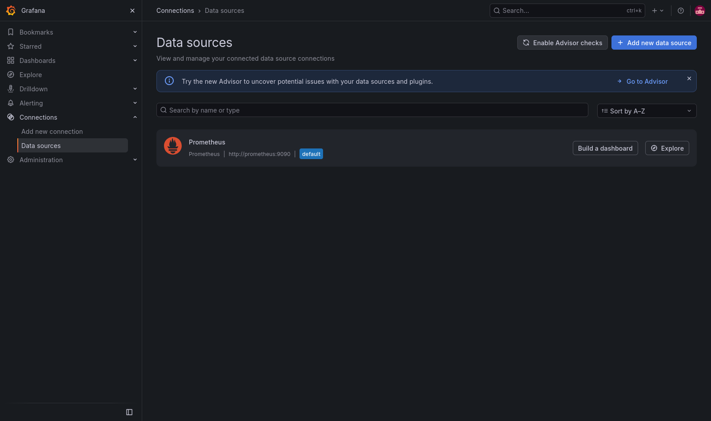

Prometheus опрашивает node-exporter и сам себя, обе цели в состоянии UP:

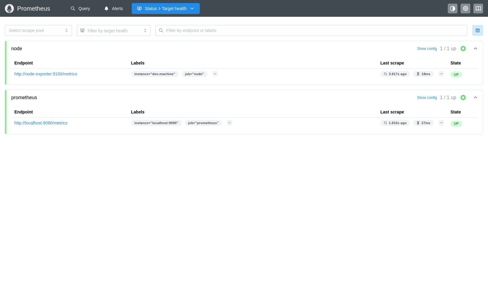

---

## Задание 2

1. [PromQL tutorial for beginners and humans](https://valyala.medium.com/promql-tutorial-for-beginners-9ab455142085).
2. [Understanding Machine CPU usage](https://www.robustperception.io/understanding-machine-cpu-usage).
3. [Introduction to PromQL, the Prometheus query language](https://grafana.com/blog/2020/02/04/introduction-to-promql-the-prometheus-query-language/).

Создайте Dashboard и в ней создайте Panels:

- утилизация CPU для nodeexporter (в процентах, 100-idle);
- CPULA 1/5/15;
- количество свободной оперативной памяти;
- количество места на файловой системе.

Для решения этого задания приведите promql-запросы для выдачи этих метрик, а также скриншот получившейся Dashboard.

## Ответ

Дашборд «Ресурсы машины (node-exporter)» в папке Netology, 4 панели:

| Панель | PromQL |
|---|---|
| Утилизация CPU, % | `100 - avg by (instance) (rate(node_cpu_seconds_total{mode="idle"}[$__rate_interval])) * 100` |
| CPU LA 1/5/15 | `node_load1`, `node_load5`, `node_load15`; для сравнения число ядер: `count by (instance) (node_cpu_seconds_total{mode="idle"})` |
| Свободная оперативная память | `node_memory_MemAvailable_bytes`, `node_memory_MemFree_bytes`; всего - `node_memory_MemTotal_bytes` |
| Место на файловой системе / | свободно - `node_filesystem_avail_bytes{mountpoint="/"}`, размер - `node_filesystem_size_bytes{mountpoint="/"}` |


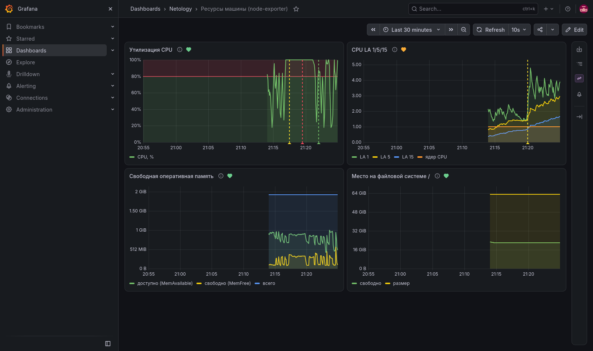

---

## Задание 3

1. Создайте для каждой Dashboard подходящее правило alert — можно обратиться к первой лекции в блоке «Мониторинг».
2. В качестве решения задания приведите скриншот вашей итоговой Dashboard.

## Ответ

На каждую панель - своё правило (Grafana-managed alerting, файл `grafana/provisioning/alerting/rules.yaml`).
Правила привязаны к панелям аннотациями `__dashboardUid__` и `__panelId__`: на панели видно состояние
правила (сердечко), на графике - отметки срабатывания, в письме - ссылки на дашборд и панель.

| Панель | Правило | Условие | Сколько держится |
|---|---|---|---|
| Утилизация CPU | Высокая загрузка CPU | > 80% | 2 мин |
| CPU LA 1/5/15 | Load average выше числа ядер | LA 5 на ядро > 1,5 | 10 мин |
| Свободная оперативная память | Мало свободной памяти | MemAvailable < 10% от MemTotal | 5 мин |
| Место на файловой системе / | Мало места на диске | свободно < 10% на / | 5 мин |

**Тестовые события:**

1. Кнопка «Test» у контакта - Grafana отправляет тестовый алерт:

   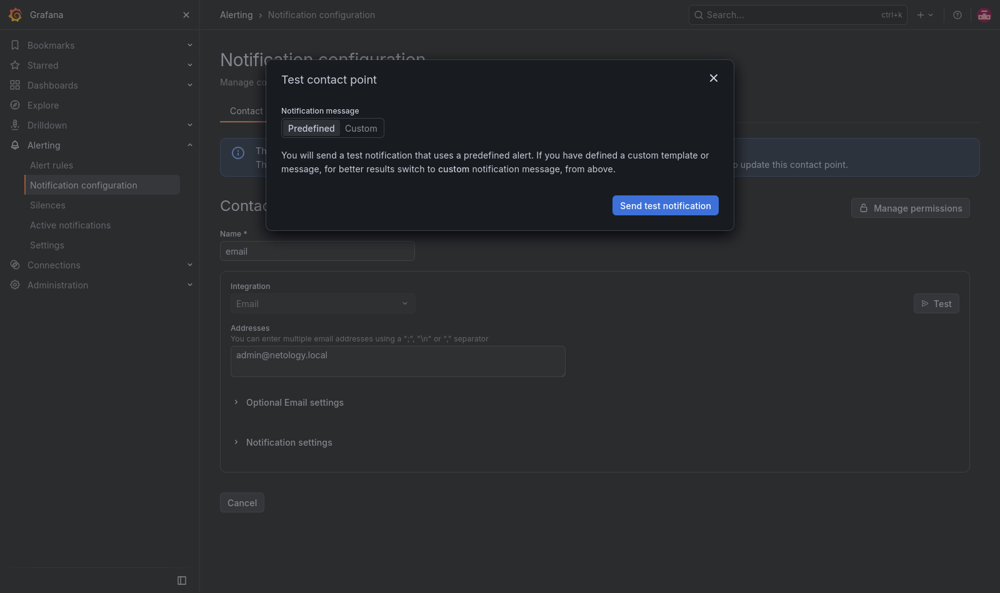

2. Настоящее срабатывание CPU: 4,5 минуты нагрузки на процессор с минимальным приоритетом, чтобы не мешать
   остальным процессам на машине:

   ```bash
   nice -n 19 timeout 270 sh -c 'while :; do :; done'
   ```

   Правило прошло путь Normal → Pending → Firing, после снятия нагрузки - Resolved.

3. Load average выше числа ядер сработал сам: у машины одно ядро, и после нагрузки и съёмки скриншотов
   в браузере LA 5 держался выше 1,5 на ядро больше 10 минут.

Все письма в почтовом ящике:

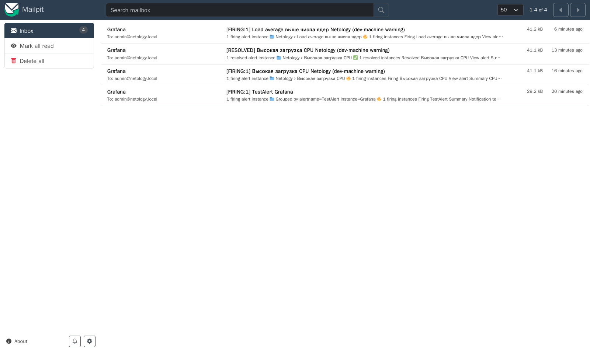

Тестовое уведомление:

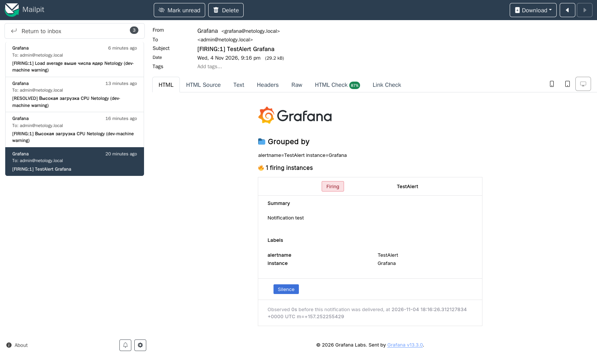

Срабатывание и восстановление CPU:

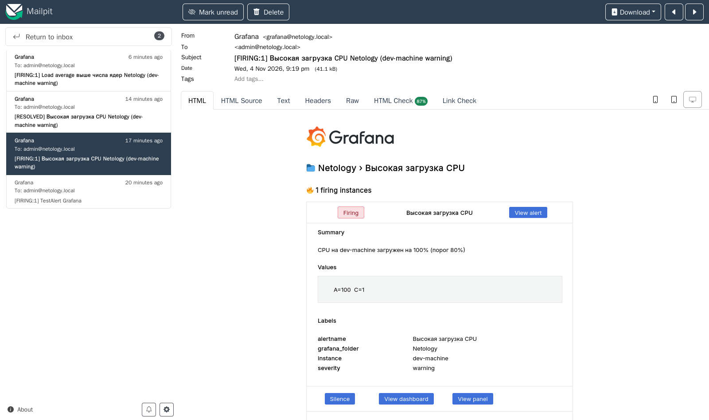

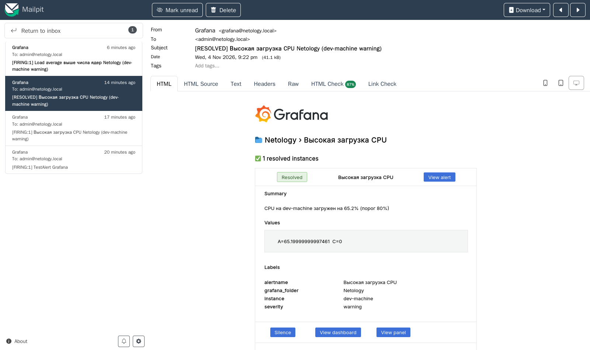

Срабатывание LA:

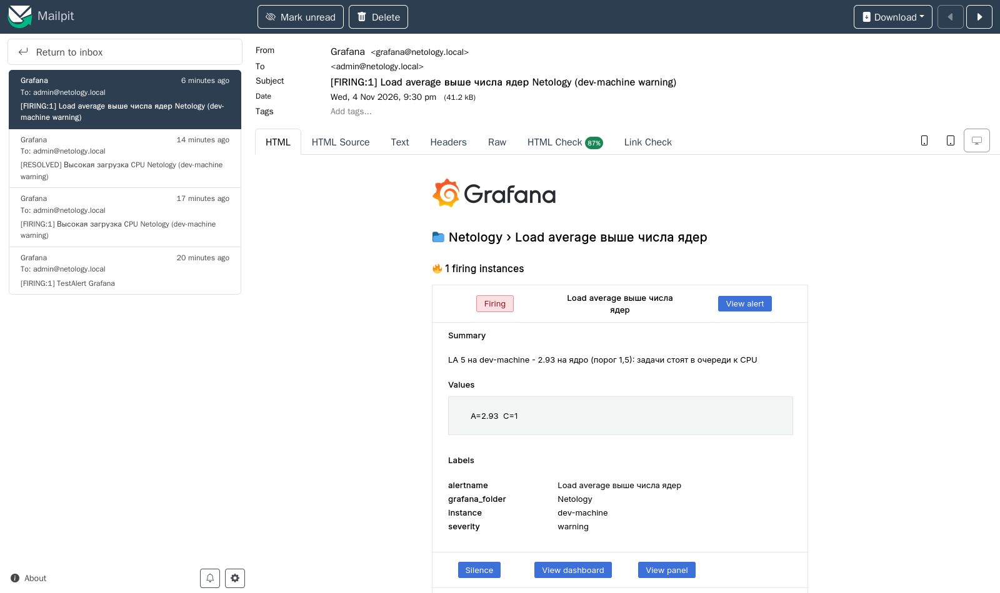

Итоговый дашборд: на панели LA сработавший алерт (красное сердечко), на графиках - отметки смены
состояний:

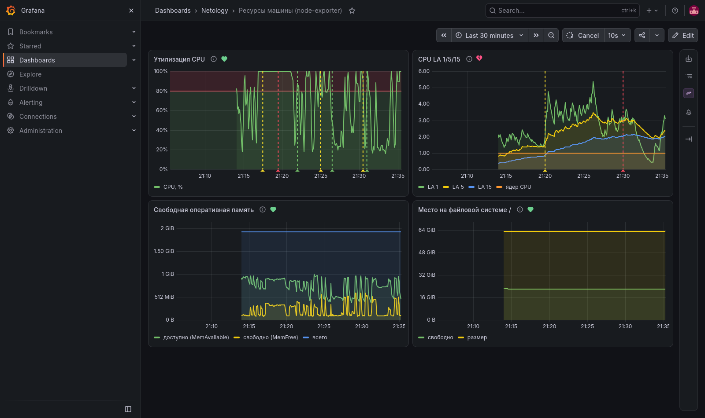

Правила алертов:

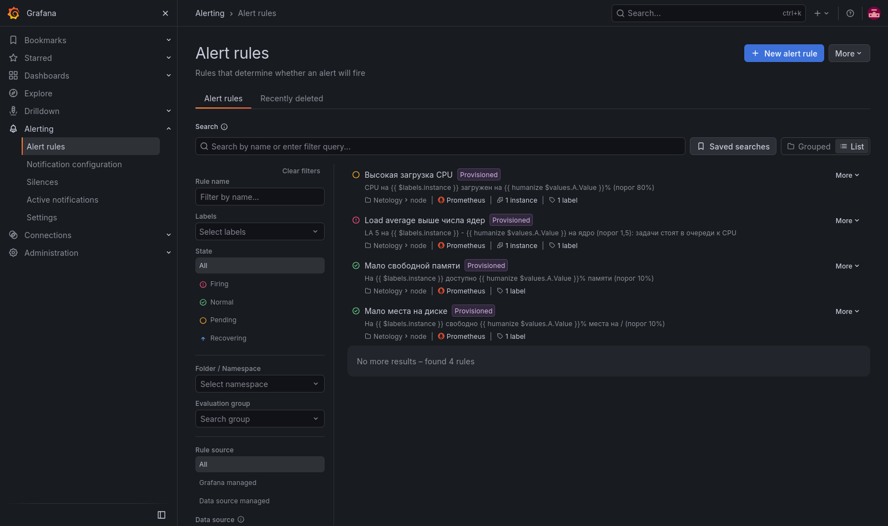

---

## Задание 4

1. Сохраните ваш Dashboard.Для этого перейдите в настройки Dashboard, выберите в боковом меню «JSON MODEL». Далее скопируйте отображаемое json-содержимое в отдельный файл и сохраните его.
2. В качестве решения задания приведите листинг этого файла.

## ответ

В Grafana 13 пункта «JSON Model» в настройках дашборда больше. Дашборд там в новой схеме
`dashboard.grafana.app/v2`:

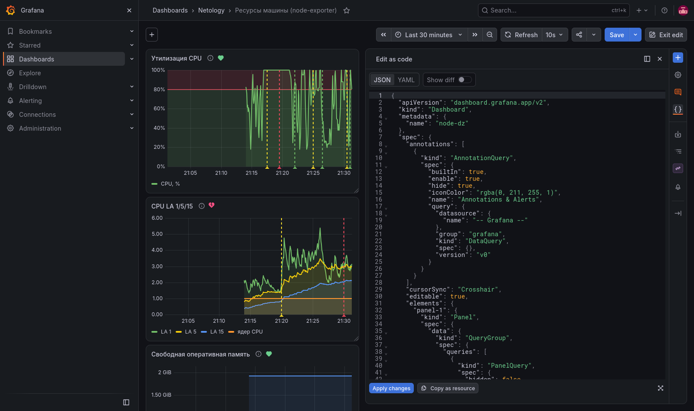


<details><summary>export-dashboard.sh</summary>

```bash
#!/bin/bash
# Сохранить дашборд в dashboard.json - то же содержимое, что Grafana 13 показывает в Edit -> Code («Edit as code», JSON):
# ресурс dashboard.grafana.app/v2 без служебных полей metadata.
set -euo pipefail
cd "$(dirname "$0")"
. ./.env
curl -sf -u "admin:$GF_ADMIN_PASSWORD" \
  http://127.0.0.1:3000/apis/dashboard.grafana.app/v2/namespaces/default/dashboards/node-dz |
  python3 -c '
import json, sys
d = json.load(sys.stdin)
out = {"apiVersion": d["apiVersion"], "kind": d["kind"], "metadata": {"name": d["metadata"]["name"]}, "spec": d["spec"]}
json.dump(out, sys.stdout, ensure_ascii=False, indent=2, sort_keys=True)  # ключи по алфавиту, как в редакторе
print()' > dashboard.json
echo "dashboard.json: $(wc -l < dashboard.json) строк"
```
</details>

<details><summary>dashboard.json</summary>

```json
{
  "apiVersion": "dashboard.grafana.app/v2",
  "kind": "Dashboard",
  "metadata": {
    "name": "node-dz"
  },
  "spec": {
    "annotations": [
      {
        "kind": "AnnotationQuery",
        "spec": {
          "builtIn": true,
          "enable": true,
          "hide": true,
          "iconColor": "rgba(0, 211, 255, 1)",
          "legacyOptions": {
            "type": "dashboard"
          },
          "name": "Annotations & Alerts",
          "query": {
            "datasource": {
              "name": "-- Grafana --"
            },
            "group": "grafana",
            "kind": "DataQuery",
            "spec": {},
            "version": "v0"
          }
        }
      }
    ],
    "cursorSync": "Crosshair",
    "editable": true,
    "elements": {
      "panel-1": {
        "kind": "Panel",
        "spec": {
          "data": {
            "kind": "QueryGroup",
            "spec": {
              "queries": [
                {
                  "kind": "PanelQuery",
                  "spec": {
                    "hidden": false,
                    "query": {
                      "datasource": {
                        "name": "prometheus"
                      },
                      "group": "prometheus",
                      "kind": "DataQuery",
                      "spec": {
                        "expr": "100 - avg by (instance) (rate(node_cpu_seconds_total{mode=\"idle\"}[$__rate_interval])) * 100",
                        "legendFormat": "CPU, %",
                        "range": true
                      },
                      "version": "v0"
                    },
                    "refId": "A"
                  }
                }
              ],
              "queryOptions": {},
              "transformations": []
            }
          },
          "description": "100 - доля времени простоя (idle) по всем ядрам",
          "id": 1,
          "links": [],
          "title": "Утилизация CPU",
          "vizConfig": {
            "group": "timeseries",
            "kind": "VizConfig",
            "spec": {
              "fieldConfig": {
                "defaults": {
                  "custom": {
                    "fillOpacity": 10,
                    "lineWidth": 2,
                    "showPoints": "never",
                    "thresholdsStyle": {
                      "mode": "line+area"
                    }
                  },
                  "max": 100,
                  "min": 0,
                  "thresholds": {
                    "mode": "absolute",
                    "steps": [
                      {
                        "color": "green",
                        "value": null
                      },
                      {
                        "color": "red",
                        "value": 80
                      }
                    ]
                  },
                  "unit": "percent"
                },
                "overrides": []
              },
              "options": {
                "legend": {
                  "displayMode": "list",
                  "placement": "bottom",
                  "showLegend": true
                },
                "tooltip": {
                  "mode": "multi",
                  "sort": "none"
                }
              }
            },
            "version": ""
          }
        }
      },
      "panel-2": {
        "kind": "Panel",
        "spec": {
          "data": {
            "kind": "QueryGroup",
            "spec": {
              "queries": [
                {
                  "kind": "PanelQuery",
                  "spec": {
                    "hidden": false,
                    "query": {
                      "datasource": {
                        "name": "prometheus"
                      },
                      "group": "prometheus",
                      "kind": "DataQuery",
                      "spec": {
                        "expr": "node_load1",
                        "legendFormat": "LA 1",
                        "range": true
                      },
                      "version": "v0"
                    },
                    "refId": "A"
                  }
                },
                {
                  "kind": "PanelQuery",
                  "spec": {
                    "hidden": false,
                    "query": {
                      "datasource": {
                        "name": "prometheus"
                      },
                      "group": "prometheus",
                      "kind": "DataQuery",
                      "spec": {
                        "expr": "node_load5",
                        "legendFormat": "LA 5",
                        "range": true
                      },
                      "version": "v0"
                    },
                    "refId": "B"
                  }
                },
                {
                  "kind": "PanelQuery",
                  "spec": {
                    "hidden": false,
                    "query": {
                      "datasource": {
                        "name": "prometheus"
                      },
                      "group": "prometheus",
                      "kind": "DataQuery",
                      "spec": {
                        "expr": "node_load15",
                        "legendFormat": "LA 15",
                        "range": true
                      },
                      "version": "v0"
                    },
                    "refId": "C"
                  }
                },
                {
                  "kind": "PanelQuery",
                  "spec": {
                    "hidden": false,
                    "query": {
                      "datasource": {
                        "name": "prometheus"
                      },
                      "group": "prometheus",
                      "kind": "DataQuery",
                      "spec": {
                        "expr": "count by (instance) (node_cpu_seconds_total{mode=\"idle\"})",
                        "legendFormat": "ядер CPU",
                        "range": true
                      },
                      "version": "v0"
                    },
                    "refId": "D"
                  }
                }
              ],
              "queryOptions": {},
              "transformations": []
            }
          },
          "description": "Load average за 1, 5 и 15 минут; для сравнения - число ядер",
          "id": 2,
          "links": [],
          "title": "CPU LA 1/5/15",
          "vizConfig": {
            "group": "timeseries",
            "kind": "VizConfig",
            "spec": {
              "fieldConfig": {
                "defaults": {
                  "custom": {
                    "fillOpacity": 10,
                    "lineWidth": 2,
                    "showPoints": "never"
                  },
                  "decimals": 2,
                  "min": 0,
                  "unit": "short"
                },
                "overrides": []
              },
              "options": {
                "legend": {
                  "displayMode": "list",
                  "placement": "bottom",
                  "showLegend": true
                },
                "tooltip": {
                  "mode": "multi",
                  "sort": "none"
                }
              }
            },
            "version": ""
          }
        }
      },
      "panel-3": {
        "kind": "Panel",
        "spec": {
          "data": {
            "kind": "QueryGroup",
            "spec": {
              "queries": [
                {
                  "kind": "PanelQuery",
                  "spec": {
                    "hidden": false,
                    "query": {
                      "datasource": {
                        "name": "prometheus"
                      },
                      "group": "prometheus",
                      "kind": "DataQuery",
                      "spec": {
                        "expr": "node_memory_MemAvailable_bytes",
                        "legendFormat": "доступно (MemAvailable)",
                        "range": true
                      },
                      "version": "v0"
                    },
                    "refId": "A"
                  }
                },
                {
                  "kind": "PanelQuery",
                  "spec": {
                    "hidden": false,
                    "query": {
                      "datasource": {
                        "name": "prometheus"
                      },
                      "group": "prometheus",
                      "kind": "DataQuery",
                      "spec": {
                        "expr": "node_memory_MemFree_bytes",
                        "legendFormat": "свободно (MemFree)",
                        "range": true
                      },
                      "version": "v0"
                    },
                    "refId": "B"
                  }
                },
                {
                  "kind": "PanelQuery",
                  "spec": {
                    "hidden": false,
                    "query": {
                      "datasource": {
                        "name": "prometheus"
                      },
                      "group": "prometheus",
                      "kind": "DataQuery",
                      "spec": {
                        "expr": "node_memory_MemTotal_bytes",
                        "legendFormat": "всего",
                        "range": true
                      },
                      "version": "v0"
                    },
                    "refId": "C"
                  }
                }
              ],
              "queryOptions": {},
              "transformations": []
            }
          },
          "description": "MemAvailable - сколько памяти можно отдать процессам без свопа (включая освобождаемый кеш); MemFree - совсем не занятая",
          "id": 3,
          "links": [],
          "title": "Свободная оперативная память",
          "vizConfig": {
            "group": "timeseries",
            "kind": "VizConfig",
            "spec": {
              "fieldConfig": {
                "defaults": {
                  "custom": {
                    "fillOpacity": 10,
                    "lineWidth": 2,
                    "showPoints": "never"
                  },
                  "min": 0,
                  "unit": "bytes"
                },
                "overrides": []
              },
              "options": {
                "legend": {
                  "displayMode": "list",
                  "placement": "bottom",
                  "showLegend": true
                },
                "tooltip": {
                  "mode": "multi",
                  "sort": "none"
                }
              }
            },
            "version": ""
          }
        }
      },
      "panel-4": {
        "kind": "Panel",
        "spec": {
          "data": {
            "kind": "QueryGroup",
            "spec": {
              "queries": [
                {
                  "kind": "PanelQuery",
                  "spec": {
                    "hidden": false,
                    "query": {
                      "datasource": {
                        "name": "prometheus"
                      },
                      "group": "prometheus",
                      "kind": "DataQuery",
                      "spec": {
                        "expr": "node_filesystem_avail_bytes{mountpoint=\"/\"}",
                        "legendFormat": "свободно",
                        "range": true
                      },
                      "version": "v0"
                    },
                    "refId": "A"
                  }
                },
                {
                  "kind": "PanelQuery",
                  "spec": {
                    "hidden": false,
                    "query": {
                      "datasource": {
                        "name": "prometheus"
                      },
                      "group": "prometheus",
                      "kind": "DataQuery",
                      "spec": {
                        "expr": "node_filesystem_size_bytes{mountpoint=\"/\"}",
                        "legendFormat": "размер",
                        "range": true
                      },
                      "version": "v0"
                    },
                    "refId": "B"
                  }
                }
              ],
              "queryOptions": {},
              "transformations": []
            }
          },
          "description": "Корневая файловая система: свободное место (доступное непривилегированным пользователям) и размер",
          "id": 4,
          "links": [],
          "title": "Место на файловой системе /",
          "vizConfig": {
            "group": "timeseries",
            "kind": "VizConfig",
            "spec": {
              "fieldConfig": {
                "defaults": {
                  "custom": {
                    "fillOpacity": 10,
                    "lineWidth": 2,
                    "showPoints": "never"
                  },
                  "min": 0,
                  "unit": "bytes"
                },
                "overrides": []
              },
              "options": {
                "legend": {
                  "displayMode": "list",
                  "placement": "bottom",
                  "showLegend": true
                },
                "tooltip": {
                  "mode": "multi",
                  "sort": "none"
                }
              }
            },
            "version": ""
          }
        }
      }
    },
    "layout": {
      "kind": "GridLayout",
      "spec": {
        "items": [
          {
            "kind": "GridLayoutItem",
            "spec": {
              "element": {
                "kind": "ElementReference",
                "name": "panel-1"
              },
              "height": 9,
              "width": 12,
              "x": 0,
              "y": 0
            }
          },
          {
            "kind": "GridLayoutItem",
            "spec": {
              "element": {
                "kind": "ElementReference",
                "name": "panel-2"
              },
              "height": 9,
              "width": 12,
              "x": 12,
              "y": 0
            }
          },
          {
            "kind": "GridLayoutItem",
            "spec": {
              "element": {
                "kind": "ElementReference",
                "name": "panel-3"
              },
              "height": 9,
              "width": 12,
              "x": 0,
              "y": 9
            }
          },
          {
            "kind": "GridLayoutItem",
            "spec": {
              "element": {
                "kind": "ElementReference",
                "name": "panel-4"
              },
              "height": 9,
              "width": 12,
              "x": 12,
              "y": 9
            }
          }
        ]
      }
    },
    "links": [],
    "liveNow": false,
    "preferences": {
      "layout": {
        "kind": "GridLayout",
        "spec": {
          "items": []
        }
      }
    },
    "preload": false,
    "tags": [
      "netology",
      "node-exporter"
    ],
    "timeSettings": {
      "autoRefresh": "10s",
      "autoRefreshIntervals": [
        "5s",
        "10s",
        "30s",
        "1m",
        "5m",
        "15m",
        "30m",
        "1h",
        "2h",
        "1d"
      ],
      "fiscalYearStartMonth": 0,
      "from": "now-30m",
      "hideTimepicker": false,
      "timezone": "browser",
      "to": "now"
    },
    "title": "Ресурсы машины (node-exporter)",
    "variables": []
  }
}
```
</details>
